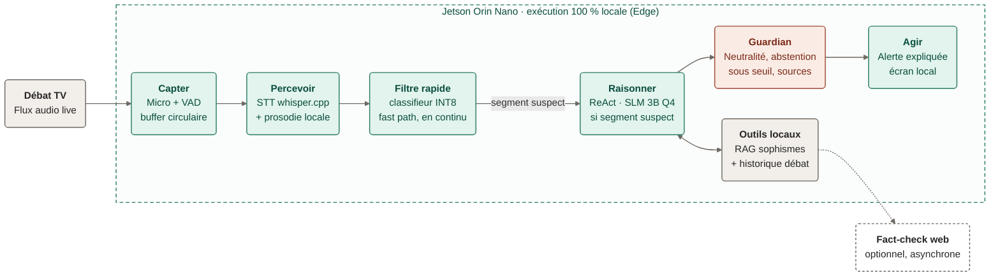
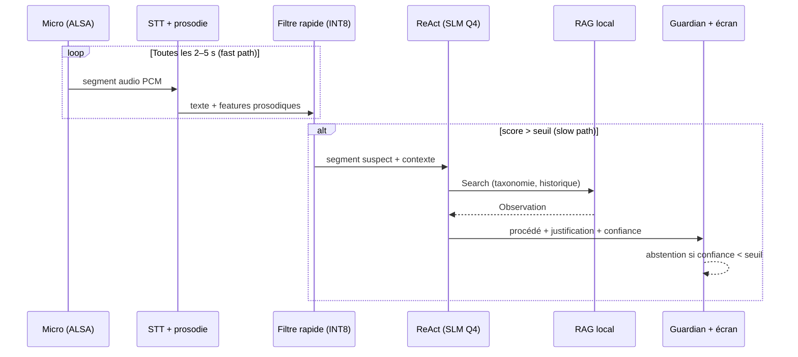

# Architecture Diagrams

Use this file to document your agent architecture with [Mermaid.js](https://mermaid.js.org/) diagrams (ReAct loops, trust filters, simulation interfaces, etc.).

## Agent architecture

Tout ce qui se trouve dans le cadre « Jetson Orin Nano » s’exécute en local. Seule la vérification factuelle web (optionnelle, asynchrone) sort du boîtier.

## Edge pipeline (fast path / slow path)

